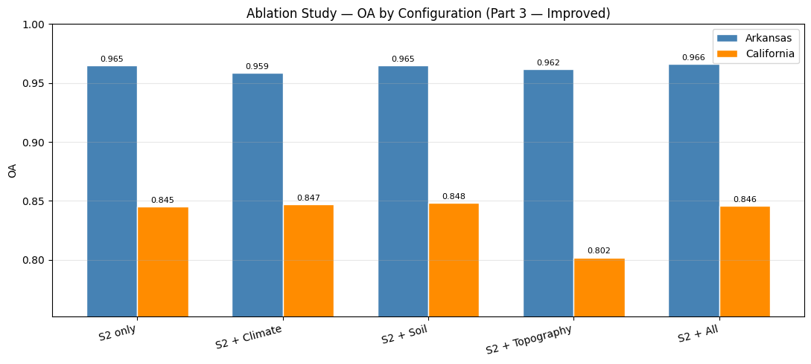
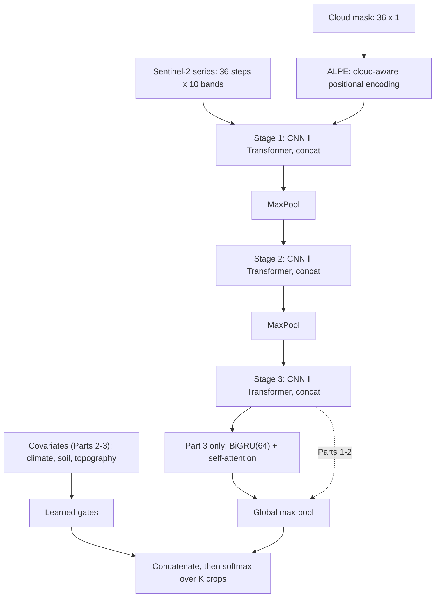

# MCTNet Crop Classification — Reproduction, Covariate Ablation & BiGRU Extension

Pixel-level crop-type mapping from **Sentinel-2 time series** (Arkansas and California, 2021) with a CNN–Transformer network (**MCTNet**, Wang et al., 2024). The project has three parts: (1) reproduce the published baseline in TensorFlow/Keras, (2) test whether environmental covariates (climate, soil, topography) help, and (3) extend the architecture with a BiGRU and vegetation indices.

> Coursework for the *Neural Networks* module, Master 1 SII, USTHB (2025–2026), by **Ghena Hani** and **Samy Nazim Drinali**. The full write-up is in [`report/`](report/MCTNet_Crop_Classification_Report.pdf).

## Results at a glance

Test-set Overall Accuracy (OA), Cohen's κ and macro-F1. Single training run per configuration (seed 42).

| Model | Arkansas OA | κ | F1 | California OA | κ | F1 |
|---|---|---|---|---|---|---|
| Wang et al. (published MCTNet) | 0.968 | 0.951 | 0.933 | 0.852 | 0.806 | 0.829 |
| Part 1 — our reproduction | 0.937 | 0.905 | 0.885 | 0.791 | 0.730 | 0.743 |
| Part 2 — S2 only | 0.940 | 0.910 | 0.891 | 0.789 | 0.727 | 0.735 |
| Part 2 — S2 + all covariates | 0.952 | 0.927 | 0.908 | 0.832 | 0.777 | 0.788 |
| Part 3 — improved, S2 only | 0.965 | 0.944 | 0.907 | 0.845 | 0.787 | 0.802 |
| Part 3 — improved, S2 + all covariates | 0.966 | 0.945 | 0.910 | 0.846 | 0.790 | 0.800 |

The published numbers come from the paper and are **not directly comparable** with ours (see [Limitations](#limitations-read-this-before-citing-any-number)).



## What each part does

| Part | Notebook | What changes | Model size |
|---|---|---|---|
| Data | `01_extract_sentinel2_gee.ipynb`, `02_enrich_covariates_gee.ipynb` | Sentinel-2 SR time series + USDA Cropland Data Layer labels via Google Earth Engine; ERA5 climate, OpenLandMap soil, ALOS landform covariates | — |
| 1 | `03_part1_baseline_mctnet.ipynb` | Re-implementation of MCTNet: 3 CNN‖Transformer stages + cloud-aware positional encoding (ALPE) | 29,489 params (Part 2 S2-only count; Part 1 count was not printed) |
| 2 | `04_part2_covariate_ablation.ipynb` | Gated covariate branch; 5 input configurations (S2, +Climate, +Soil, +Topography, +All) | 29K–39K |
| 3 | `05_part3_improved_mctnet_bigru.ipynb` | BiGRU(64) + attention after stage 3, 4 vegetation indices (NDVI, IRECI, MTCI, S2REP), cloud-gap interpolation, per-group covariate gates, 500 samples/class | 125K–134K |



## Ablation results

**Part 2** (original architecture, 300 samples/class):

| Config | AR OA | AR F1 | CA OA | CA F1 |
|---|---|---|---|---|
| S2 only | 0.940 | 0.891 | 0.789 | 0.735 |
| S2 + Climate | 0.943 | 0.893 | 0.818 | 0.775 |
| S2 + Soil | 0.947 | 0.905 | 0.805 | 0.756 |
| S2 + Topography | 0.954 | 0.911 | 0.808 | 0.757 |
| S2 + All | 0.952 | 0.908 | 0.832 | 0.788 |

**Part 3** (improved architecture, 500 samples/class):

| Config | AR OA | AR F1 | CA OA | CA F1 | Params (AR) |
|---|---|---|---|---|---|
| S2 only | 0.965 | 0.907 | 0.845 | 0.802 | 124,951 |
| S2 + Climate | 0.959 | 0.895 | 0.847 | 0.795 | 134,276 |
| S2 + Soil | 0.965 | 0.909 | 0.848 | 0.800 | 127,841 |
| S2 + Topography | 0.962 | 0.902 | **0.802** | **0.731** | 127,841 |
| S2 + All | 0.966 | 0.910 | 0.846 | 0.800 | 128,953 |

## What the results do and do not show

- **Covariates help the original architecture** (Part 2). The largest gain is California with all covariates: +4.3 pp OA and +5.3 pp F1 over S2-only.
- **Once the BiGRU and vegetation indices are added, covariates stop mattering much** (Part 3). S2 + All is within about 0.1 pp OA of S2-only in both states, and S2 + Topography *hurts* California by 4.3 pp OA. That drop was not investigated.
- **A single shared gate showed negative transfer in Part 2**: on Arkansas, S2 + All (OA 0.952, F1 0.908) scores below S2 + Topography (0.954, 0.911). Per-group gates were introduced in Part 3, but Part 3 does not show the clean monotonic improvement one might expect, so treat the gating fix as unproven.
- **Class imbalance still bites.** In Arkansas the *Others* class has precision around 0.5 at recall around 0.95 (balanced class weights over-predict it), which caps macro-F1 near 0.91. In California, Almonds vs Pistachios remains the hardest pair.

## Limitations (read this before citing any number)

1. **Not comparable to the paper.** We re-extracted our own datasets from Google Earth Engine (about 10,000 pixels per state), so the sample set, class balance and split protocol differ from Wang et al. The 3–6 pp gap to the published OA is *not* diagnosed. The report attributes it to framework defaults (PyTorch vs TensorFlow initialisation and BatchNorm momentum); that is a plausible hypothesis that was not tested.
2. **Part 3 is a confounded comparison.** It changes the architecture (about 4x more parameters), the input features, the preprocessing *and* the training set size (300 → 500 per class) at once, so the gain over Part 2 cannot be credited to the BiGRU alone. A controlled ablation holding the data constant is the obvious next experiment.
3. **One run per configuration.** Seeds are fixed (42) but there are no repeated runs, confidence intervals or significance tests. Differences below roughly 1 pp should be read as noise.
4. **Test sets differ between parts.** Part 1–2 use about 8,200–8,500 test pixels per state; Part 3 uses about 7,590 for Arkansas because more pixels move into training.
5. **Single year, two states, pixel-level split.** No spatial hold-out, so spatial autocorrelation can inflate scores; results say nothing about other seasons or regions.

## Data

The CSVs (≈60–85 MB each) are **not stored in git**. See [`data/README.md`](data/README.md) for how to regenerate them with the extraction notebooks or download the release archive.

- Imagery: Sentinel-2 Surface Reflectance (Harmonized), Copernicus programme
- Labels: USDA NASS Cropland Data Layer
- Covariates: ERA5 (climate), OpenLandMap (soil), ALOS landforms
- Please check each provider's terms and attribution requirements before reuse.

## Reproducing

The notebooks were written for **Google Colab** with Google Drive mounted.

1. Open the notebooks in Colab (a GPU runtime speeds up Parts 1–3).
2. Notebooks 01–02: authenticate with Earth Engine and replace `YOUR_GEE_PROJECT_ID` with your own Cloud project.
3. Put the CSVs in your Drive and set `FOLDER` in the first cells (the notebooks default to `/content/drive/MyDrive/Colab Notebooks`, and notebook 02 uses `/content/drive/MyDrive/MCTNet_Data`).
4. Note: notebook 03 loads `MCTNet_<State>_2021.csv`, while the provided cleaned files are `MCTNet_<State>_2021_fixed.csv`. Rename the files or edit the filename in the load cell.
5. Run notebooks 03 → 04 → 05 in order. Package versions are not pinned; `requirements.txt` lists the libraries used.

## Repository layout

```
notebooks/   data extraction, covariate enrichment, Parts 1-3
report/      project report (PDF; cover page omitted because it lists student ID numbers)
docs/figures/ figures reused in this README
data/        data instructions (CSVs excluded from git)
scripts/     helper script used to publish this repository
```

## Reference

Wang et al. (2024), *MCTNet*, Computers and Electronics in Agriculture. Full reference list is in the report.

## License

Code and notebooks: MIT (see `LICENSE`). The report is © the authors. Data derived from third-party sources remains subject to those sources' terms.
